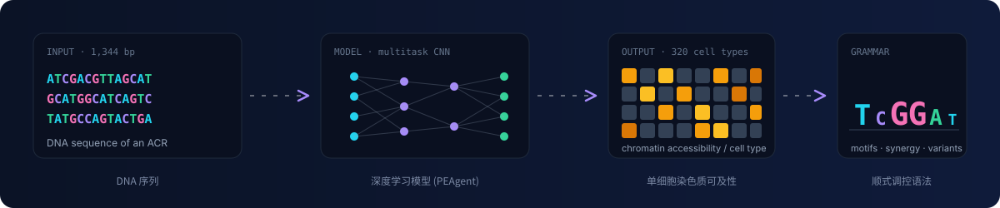

 

 

## 🧬 About · 关于我

Postdoctoral researcher in the **Schmitz Lab, University of Georgia**, working at the intersection of **AI for Science** and plant biology. I build deep-learning and epigenome-informed foundation models to decode how plant genomes encode cell-type-specific regulation. Ph.D. in Bioinformatics, Zhejiang University.

> 佐治亚大学 Schmitz 实验室博士后。用深度学习 × 单细胞/空间多组学，解码植物基因组的细胞类型特异性调控逻辑。浙江大学生物信息学博士。

<table>
<tr>
<td width="33%" valign="top">

<b>🤖 AI for Plant Genomics</b> 
Sequence-to-function deep learning; epigenome-informed foundation models. 
面向植物基因组的序列→功能深度学习与基础模型

</td>
<td width="33%" valign="top">

<b>🔬 Single-cell &amp; Spatial Multi-omics</b> 
scATAC / scRNA / spatial transcriptomics; computational methods & atlases. 
单细胞与空间多组学：方法开发与图谱构建

</td>
<td width="33%" valign="top">

<b>🌱 Plant Epigenetics</b> 
Chromatin accessibility, <i>cis</i>-regulatory grammar, and its evolution across crops. 
染色质可及性、顺式调控语法及其在作物间的演化

</td>
</tr>
</table>

## 🚀 Featured Projects · 精选项目

<table>
<tr>
<td align="center" width="50%">
 
Python package for the PEAgent models — predict single-cell chromatin accessibility from DNA sequence · <a href="https://yaoj-bioin.github.io/peagent_tool/">Docs</a> PEAgent 推理包：从 DNA 序列预测单细胞染色质可及性
</td>
<td align="center" width="50%">
 
Analysis code for the PEAgent manuscript — training, motif lexicon, synergy, cross-species, variant effects PEAgent 论文分析代码：训练、motif 词典、协同、跨物种、变异效应
</td>
</tr>
<tr>
<td align="center" width="50%">
 
JBrowse 2 plugin rendering base-resolution attribution maps (scBasset / BPNet) as sequence logos JBrowse 2 插件：以序列 logo 形式展示碱基级模型归因图
</td>
<td align="center" width="50%">
 
R package to quantify protoplasting-induced artifacts in plant scRNA-seq R 包：系统评估原生质体化对植物单细胞转录组的影响
</td>
</tr>
<tr>
<td align="center" width="50%">
 
Cell-wall segmentation → single-cell-resolution spatial transcriptomics for plant tissue (Stereo-seq) 植物组织细胞壁分割 → 单细胞分辨率空间转录组流程
</td>
<td align="center" width="50%">
 
A practical guide to plant spatial multi-omics analysis (companion to the <i>Trends Plant Sci</i> review) · <a href="https://yaoj-bioin.github.io/plant-spatial-multiomics-analysis/">Site</a> 植物空间多组学分析实践指南
</td>
</tr>
</table>

## 📝 Selected Publications · 代表论文

† co-first author · Full list on my <a href="https://yaoj-bioin.github.io/Jie_academic_homepage/#publications">homepage</a> / <a href="https://scholar.google.com/citations?user=CXUsnsAAAAAJ">Google Scholar</a>

| | |
|:--|:--|
|  | **Yao J**, Li J, Zhang X, Li X, Marand AP, Pickering E, Schmitz RJ. *Sequence-based modeling of plant epigenomes reveals cell-type-specific cis-regulatory grammar.* [DOI](https://doi.org/10.64898/2026.07.22.740070) · [peagent.org](https://peagent.org/) |
|  | **Yao J**, Marand AP, Bai Y, Schmitz RJ, Fan L. *Advances in plant spatial multi-omics data analysis.* [DOI](https://doi.org/10.1016/j.tplants.2025.10.005) |
|  | **Yao J†**, Chu Q†, Guo X†, Shao W†, et al., Liu H, Fan L. *Spatiotemporal transcriptomic landscape of rice embryonic cells during seed germination.* [DOI](https://doi.org/10.1016/j.devcel.2024.05.016) |
|  | **Yao J**, Shang N, Chen H, et al., Chu Q. *Sub-clustering, marker identification and multi-omics integration influenced by protoplasting in plant scRNA-seq data analysis.* [DOI](https://doi.org/10.1101/2024.12.14.628512) |
|  | Zheng Y†, **Yao J†**, et al., Fan L. *A manually curated database and analysis platform of cell markers of scars.* [DOI](https://doi.org/10.1016/j.jid.2022.10.008) |

Also contributed to: *The Plant Cell* 2026 · *Nature Plants* 2026 (scPlantReg) · *Molecular Plant* 2025 ×2 · *Briefings in Bioinformatics* 2025 · *Molecular Plant* 2021 (PlantscRNAdb)

## 🛠️ Tech Stack · 技术栈

## 📊 GitHub Stats

🏅 3× National Scholarship · Outstanding Doctoral Graduate, ZJU 2025 · Reviewer for <i>Communications Biology</i>
  

